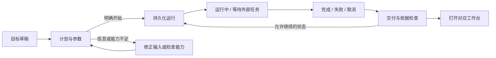

# BDA Bot 工作区、导航与执行交互规范

状态：活跃；与当前后端契约共同使用。
最后核验：2026-10-24（整理说明；原实测日期与结果见正文）。
权威范围：工作区交互规范；执行限制以当前 API 为准。
数据来源：版本化源码、组件测试和正文注明的浏览器验收。
替代关系：当前发布结论见 [公开版本准备](PUBLIC_RELEASE_READINESS.md)。

调研与实现日期：2026-10-20。补充 [前端工作台标准](FRONTEND_UX_STANDARD.md)，适用于已有 React 工作台与新增功能。

## 1. 产品目标与依据

用户有两条同等重要的路径：快速说明目标并委托 Bot；随时核查依据、参数和实际执行。Bot 是贯穿工作台的操作入口，项目和持久化执行记录是信息的归属。

| 一手资料 / 开源参考 | 采用原则 | BDA 的具体选择 |
| --- | --- | --- |
| [Fluent 2：Handoffs](https://fluent2.microsoft.design/handoffs) | 流程交接保留必要上下文，明确下一步和去向 | 项目 ID、对象和任务不能在跨页面时丢失；打开目标工作台后关闭遮挡它的助手抽屉 |
| [Fluent 2：Interaction behavior](https://fluent2.microsoft.design/content-engineering/design-interaction-behavior/) | 定义触发、响应路径和停止条件；错误后提供可执行的恢复动作 | 发起、计划检查、运行、交付、继续分别有契约；能力不足时指出阻塞项 |
| [Fluent 2：Toolbar](https://fluent2.microsoft.design/components/web/react/core/toolbar/usage) | 工具栏放当前任务的常用动作，逻辑分组，空间不足使用带文字的更多菜单 | Bot 常驻；低频交接和外部授权进入助手更多菜单 |
| [VS Code：Review agent changes](https://code.visualstudio.com/docs/agents/run/review-code-edits) | 从助手直接检查实际产物，并支持修订 | 任务详情连接交付、证据、参数和调用记录，输出可进入对应工作台 |
| [VS Code：User and workspace settings](https://code.visualstudio.com/docs/configure/settings) | 明确设置作用范围 | 个人偏好、项目模型配置、连接与管理分开；单次执行预算在计划中设置 |
| [WCAG 2.2：Focus not obscured](https://www.w3.org/WAI/WCAG22/Understanding/focus-not-obscured-minimum.html) | 聚焦的控件不能被作者创建的内容完全遮挡 | 标签与关闭按钮保持可达；抽屉关闭恢复焦点；真实导航后露出目标页面 |
| [microsoft/vscode](https://github.com/microsoft/vscode)、[microsoft/fluentui](https://github.com/microsoft/fluentui) | 开源工作区和组件组织参考 | 复用当前 Base UI / ReUI 组件体系，不引入第二套 UI 库 |

上述资料给出原则；下面的标签名、阈值、布局和信息分组是 BDA 的产品决策，并非外部标准强制要求。采用 Playwright 技能与仓库浏览器回归工具验证。

## 2. 两条路径与信息架构

1. **发起工作**：常驻 Bot 按钮 → 说明目标 → 查看负责人、计划、关键参数与写入范围 → 开始 → 查看进度/交付。
2. **核查工作**：同一 Bot 按钮 → 决策与参数 → 选择执行（包括子任务）→ 查看记录参数、交付依据、调用输入/输出 → 项目决策树或关联工作台。
3. **即时问答**：对话保留为独立标签；问答转任务仍经过可见计划。
4. **辅助管理**：Bot 交接、外部接入放在助手“更多”；项目模型配置是次级操作。

手机也必须一击打开 Bot；不得把它仅放入更多菜单。大屏用文字和图标共同识别，小屏用有可访问名称的固定图标。首屏不可增加第二条冗长的全局导航。

“查看所有决策”指服务端保存的交付解释、证据、计划记录和工具执行，不表示展示模型内部隐藏推理，也不得用后生成的解释冒充真实执行日志。

## 3. 页面如何串联

| 起点 | 目标与携带信息 | 到达后的行为 |
| --- | --- | --- |
| 任意工作台 → Bot | 当前项目、页面上下文、已有选中实体（沿用现有上下文机制） | 显示当前项目，草稿按项目隔离 |
| 计划 → 执行 | 目标、负责人、服务、方法选择、写入授权和平台调用限制 | 以返回的持久化 run ID 查看执行；不等待长任务完成才返回 |
| 执行列表 → 详情 | project ID + run ID | 服务端记录核对项目归属后才读取调用记录；不得展示其他项目的结果 |
| 抽屉详情 → 完整工作区 | 复用 `/bots?project=…&view=tasks&run=…` | 同一任务可刷新、后退和复制链接；不重新启动 |
| 详情 → 交付/证据/决策树 | 项目和已有资源引用 | 使用真实路由链接，关闭遮挡目标的抽屉 |
| 工作台 → 另一工作台 | 项目 ID 与必要对象 ID；页面标签写入 URL | 浏览器后退有效；导航本身不触发执行或提交 |
| 执行 → 继续 | 当前记录版本、补充要求、保留或缩小后的授权 | 遵守既有版本冲突处理；重新读取服务端状态 |

任务参数草稿在同一会话中切换标签/关闭并重开助手时保留，切项目时隔离。方法选择也属于草稿。执行记录存在于服务器，抽屉不是任务生命周期的所有者。

## 4. 执行状态契约

- 页面标签和前端动画不是执行状态；以服务端状态和交付检查为准。
- `succeeded` 只说明执行结束。缺失输入、待科学复核和证据缺口仍应可见。
- `awaiting_tasks` 是等待外部任务，不应被描述为等待用户批准。
- 加载中、无记录、读取失败分别呈现；失败提供重试并保留已加载内容。
- GET 查询和翻页不触发任务、授权或变更。
- 运行中的停止操作沿用写权限、版本和取消范围；412 重新读取，不覆盖。
- 长记录必须支持后续页。第一页不是“所有记录”；不能因默认 50/200 条截断让用户误以为历史完整。
- 费用“未设置”与零额度不同；估算费用和真实账单要区分。没有记录的数据明确说未记录。

## 5. 工具栏和设置的职责

| 位置 | 包含 | 交互约束 |
| --- | --- | --- |
| 全局顶栏 | 项目切换、Bot、搜索/跳转、活动、帮助、账号、设置 | 常用入口稳定；手机低频动作可进入更多 |
| 页面工具栏 | 当前对象的筛选、选择、导出、编辑，以及一个清晰的主要动作 | 与当前对象绑定；危险或有写入副作用的动作不伪装成导航 |
| Bot 顶部 | 当前项目、关闭、模型设置（有权限时）、更多助手工具 | 主要标签是发起任务、决策与参数、对话 |
| 偏好与帮助 | 外观、操作模式、账号入口、导览/指南 | 立即生效的偏好明确说明；关闭不能写成会撤销偏好的“取消” |
| 模型配置 | 当前项目模型、提供商及现有连接配置 | 测试/保存按钮只在此类显示，明确“保存模型配置” |
| 连接与管理 | 服务状态、计算目标、组织/审计管理（按已有权限显示） | 不在运行详情里配置系统；读取状态与测试连接应区分 |
| 单次任务计划 | 负责人、方法、授权和当前最多 6 次模型调用 | 关键值首屏可见，详细编辑可展开；开始前可核对 |

不新增“保存全部设置”语义；现有模型保存不代表保存偏好、组织配置或单次任务参数。

## 6. 信息密度与视觉语言

采用浅色石墨文字/冷色辅助强调、深色青蓝强调；沿用品牌色和科学可视化颜色约定。科技感来自清晰的任务状态、紧凑的数值、可操作的输入和可追溯证据。

- 第 1 层常显：当前项目、目标、状态、负责人、交付和待处理事项。执行详情不默认展示消息计数、未计量费用或整块执行参数。
- 第 2 层一次展开：交付章节、证据、方法快照。执行参数、记录版本、工具范围与 ID 收到页面底部默认折叠的“技术详情”；启动前展示当前调用限制和需要用户确认的授权。工具消息数不是处理轮数，不能将二者相除作为进度。
- 第 3 层按需读取：完整调用序列、每次调用参数和原始输出，支持翻页。
- 数值用等宽或等宽数字；长 ID/JSON 折行或局部滚动；不撑宽整个界面。
- 无意义的发光边框、持续动画、伪实时活动点不能代替状态信息。
- 标签控制内容层级，留白与细分隔线表达关系；不把每段解释再包一层卡片。
- 沿用 320px 起的窄屏、1100px 导航断点；助手宽度沿用 300–560px，内容始终能滚动到末尾。
- 交付跳转、关闭、开始/停止和参数操作均支持键盘；减少动态效果偏好继续生效。

## 7. 本轮实现和边界

已落实：常驻 Bot；三条主标签；辅助功能归入更多；独立执行检查列表；技术参数按需查看；调用参数展开；执行和调用记录翻页；方法草稿保留；导航关闭抽屉；任务展开到完整工作区；设置分类和范围说明。助手内的模型配置使用完整内容区域，返回后恢复草稿，不再与任务上下分屏。

沿用后端已有任务、权限、执行、确认和科学复核契约。本轮不增加自动执行能力，不把计划或静态步骤包装成真实进度。

真实后端验收补充：模型设置入口遵循配置 API 的项目写权限；保存模型后刷新当前项目的任务资格并清除旧连接测试结果。任务检查失败必须提供可操作的诊断入口。保存计划后刷新 `project-timeline`，链接携带项目和记录标识，直接展开并聚焦该记录；计划尚未关联研究目标时，也必须能看见。切换项目清除旧记录定位参数。窄屏主标签允许换行，保持至少 44px 点击高度。

状态衔接补充：记录深链优先进入可定位的时间线，不继承上次检查的筛选条件。切换项目必须关闭旧项目的记录编辑器；筛选无结果与记录不存在应分别说明，并提供恢复操作。长记录定位到标题，长来源标识符允许换行；窄屏验收同时检查文档、主滚动区和记录内容，不能只检查整页宽度。

交付内容的窄屏检查必须展开完整章节和来源列表。折叠状态下没有溢出，不能证明展开后的引用、工具调用 ID 和其他长文本可读；容器不能通过裁切隐藏这些内容。

模型配置补充：当前模型摘要只能显示已保存配置。编辑后撤销旧保存/测试提示，未保存配置不能测试；先保存，再测试。保存或测试期间锁定配置输入，失败保留草稿，空模型或空地址不可保存。内嵌按钮与全局设置底部按钮遵守同一套可用条件。

现有运行响应没有独立的历史模型配置快照，因此本轮不显示“本次运行模型”或拿当前设置冒充历史值。任务深链复用已有路由；历史模型版本、参数差异比较和逐字段来源标注需要补充契约并分别验收。

验收须覆盖需求完整性、逻辑正确性、边界、代码质量、测试、实际浏览器结果；具体记录见 [本轮审阅](BOT_INTERACTION_REVIEW.md)。

边界恢复补充：继续任务只能使用剩余额度，不能承诺后端未保证的额外轮数；发送期间锁定输入，失败保留补充文字。新的尝试先准备草稿，复制参数并清空写入授权，保留原任务链接；替换已有草稿需要明确选择。重复任务被拒绝时说明未创建任务并给出恢复步骤，不静默重放。取消请求必须等待后台确认；执行器在步骤间释放锁，取消获得锁后重新读取状态，保留已完成结果。切换项目既清除旧任务定位，也保留各自草稿。详见 [边界验收](BOT_BOUNDARY_ACCEPTANCE.md)。

当前版本创建任务统一最多调用模型 6 次；旧草稿中的轮数和费用字段仅保留为历史资料，不用于新任务请求。平台内部费用保护继续生效。执行详情中的历史限额不代表用户能在本版本修改额度。
